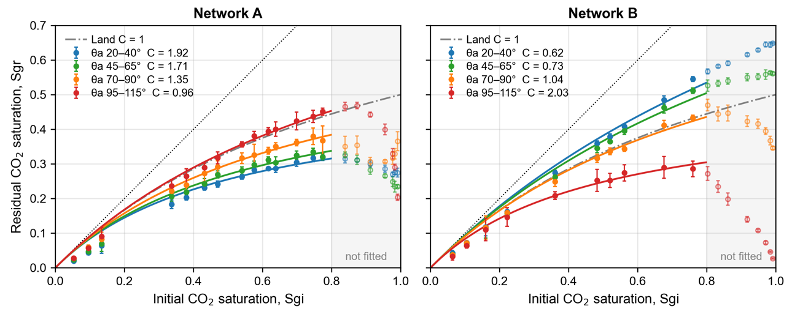

# CO2 Capillary Trapping

Selected Python workflows from a quasi-static Berea sandstone pore-network study using Imperial College PNflow. The code investigates how wettability, interfacial tension and pore geometry affect residual CO2 trapping.



## Repository structure

```text
scripts/
  run_matrix.py            Main pressure/wettability/IFT matrix
  make_variant_network.py  Controlled pore-network geometry changes
  run_geometry_sweep.py    One-property geometry sensitivity experiments
  run_combo_test.py        Combined changes with permeability matching
  parse_filling_events.py  Imbibition event-count extraction
```

This repository contains selected code only. Networks, solver binaries, raw outputs, result tables and historical drafts are not included in the current version.

## Setup

Use Python 3.10 or later:

```sh
python -m venv .venv
python -m pip install -r requirements.txt
```

Activate the environment using your platform's usual command. Obtain PNflow separately from [Imperial College London](https://github.com/ImperialCollegeLondon/pnflow). The study used unmodified upstream commit `d3c65a6`.

Supply each network as four files: `Berea_node1.dat`, `Berea_node2.dat`, `Berea_link1.dat`, `Berea_link2.dat`. Set the following environment variables to absolute paths:

| Variable | Meaning |
| --- | --- |
| `PNFLOW_EXE` | PNflow executable |
| `PNFLOW_NETWORK_A` | Directory containing network A |
| `PNFLOW_NETWORK_B` | Directory containing network B; required for geometry comparisons |

If network variables are unset, the scripts look in `data/network_A` and `data/network_B`. These directories are intentionally not tracked. The source Berea image and published network are available in the [Imperial College dataset](https://doi.org/10.6084/m9.figshare.1153794.v2). Network A was re-extracted with pnextract 2021.07.04; downloading the published network alone does not reproduce network A.

For example, in PowerShell:

```powershell
$env:PNFLOW_EXE = 'C:\tools\pnflow\pnflow.exe'
$env:PNFLOW_NETWORK_A = 'C:\networks\A'
$env:PNFLOW_NETWORK_B = 'C:\networks\B'
python scripts/run_matrix.py work/main
python scripts/run_geometry_sweep.py work/geometry
python scripts/run_combo_test.py work/combined
```

Run commands from the repository root. Each workflow writes its outputs under the work directory you provide. The full workflows launch multiple solver processes; they are not quick examples.

## Model scope

- Reference fluid properties: 50 degrees C and 10 MPa.
- Main matrix: 462 cases; drainage maxima 4.4-30 kPa, followed by imbibition to Pc = -200 kPa.
- Four advancing-angle ranges, five stochastic seeds, and IFT sensitivity cases.
- Geometry workflows vary coordination, throat radius, angularity and volume allocation.
- Sgi and Sgr are initial and residual CO2 saturations as fractions of pore volume.

These are quasi-static numerical experiments with assumed wettability, not calibrated predictions for a real core. Rate effects, dissolution and wettability evolution are absent. Geometry changes isolate model sensitivities; filling-event counts establish associations rather than proof of a unique physical mechanism.

## Attribution and reuse

PNflow is third-party software; obtain it from upstream under its own license. Source dataset: Imperial College Consortium on Pore-Scale Modelling (2014), Berea sandstone, version 2, CC BY 4.0. Extraction reference: [Dong and Blunt (2009)](https://doi.org/10.1103/PhysRevE.80.036307).

No open-source license has yet been selected for the original scripts. See `CITATION.cff` for attribution metadata.

## Checks

Packaging checks cover Python syntax/imports, 462-case enumeration, environment-configured network paths, and generated drainage/imbibition input decks. Full simulations were not rerun for this reorganization.
