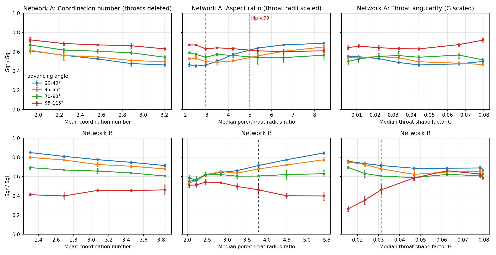

# CO2 Capillary Trapping in Berea Sandstone

Quasi-static pore-network simulations investigating interfacial tension, wettability, hysteresis, and sensitivity to network extraction.

**Author:** Mahmoud Ali | PEEG 741, Geological Storage of CO2 | November 2026

## Research question

How do interfacial properties and pore-network geometry jointly control residual CO2 trapping?

Two extractions of the same Berea micro-CT image produce opposite contact-angle trends. Controlled numerical changes to throat volume share, radius ratio and angularity recover most of that reversal. Uniform IFT scaling shifts invasion pressures but leaves the residual-versus-initial saturation relation unchanged within this quasi-static model.



## Contents

| Files | Purpose |
| --- | --- |
| `run_matrix.py` | Main 462-case pressure, wettability and IFT matrix |
| `run_angle_sweep.py`, `run_angle_sweep_oldnet.py` | Single advancing-angle sweeps |
| `run_matrix_netB_nw.py` | Additional network B angle cases |
| `run_structure_snapshots.py` | Pore-level trapping snapshots |
| `run_geometry_sweep.py` | One-property geometry ablations |
| `run_combo_test.py` | Combined geometry changes with permeability matching |
| `make_variant_network.py` | Network modification routines |
| `analyse*.py`, `plot*.py`, `summarise_geometry_sweep.py` | Analysis and figures |
| `network_pnextract/` | Network A, 4,670 pores |
| `network_B/` | Published network B, 6,298 pores |
| `old_network_DongBlunt/` | Earlier B matrix retained for comparison; not the final complete programme |
| `*.csv`, `*.json`, `*.jsonl`, `raw_runs_462.zip` | Saved numerical results and main raw-run archive |
| `RESULTS.md`, `CAUSE_A_vs_B.md` | Historical analysis notes; the notes predate some extensions |

The final report describes 1,092 simulations across blocks A-H. The 462-run archive covers the main matrix, not all extensions. Saved extension summaries are included; complete raw extension output is not bundled.

## Setup

Use Python 3.10 or later and install the analysis dependencies:

```sh
python -m venv .venv
python -m pip install -r requirements.txt
```

Activate the environment using your platform's standard command. Install/build [Imperial College PNflow](https://github.com/ImperialCollegeLondon/pnflow) separately. The study used unmodified upstream commit `d3c65a6`. The solver is third-party software and is not included here.

Set `PNFLOW_EXE` to the **absolute path** of your solver executable. For PowerShell:

```powershell
$env:PNFLOW_EXE = 'C:\tools\pnflow\pnflow.exe'
python run_matrix.py work/main
python analyse.py work/main
```

For a POSIX shell:

```sh
export PNFLOW_EXE=/absolute/path/to/pnflow
python run_matrix.py work/main
python analyse.py work/main
```

Run commands from the repository root. Simulation scripts can run multiple solver processes and require time and disk space. Analysis scripts write derived tables and figures beside the scripts; use a separate checkout if you want to preserve the included results byte-for-byte.

## Additional numerical experiments

```sh
python run_geometry_sweep.py work/geometry
python run_combo_test.py work/combined
```

Inspect each script's module docstring and arguments before running other workflows. Some plotting scripts require raw work directories from the corresponding simulations. `test_variant_builder.py` is an integration diagnostic requiring PNflow and a work-directory argument; it is not a pytest unit test.

## Definitions and conditions

- Sgi: CO2 saturation at the end of drainage, before imbibition.
- Sgr: retained CO2 saturation after imbibition to Pc = -200 kPa.
- Both saturations are fractions of pore volume.
- Pc = P_CO2 - P_water; negative Pc forces water reinvasion.
- Reference properties: 50 degrees C, 10 MPa; IFT 37.37 mN/m.
- Main drainage pressures: 4.4-30 kPa; receding angles 0-10 degrees; advancing angle ranges 20-40, 45-65, 70-90 and 95-115 degrees.
- Main stochastic seeds: 11, 23, 37, 50, 71; geometry experiments use subsets documented in code.

## Interpretation and limitations

These are numerical experiments, not experimentally calibrated predictions of Berea trapping. The model is quasi-static, with no rate effects, dissolution or evolving wettability. The image is a 2.138 mm cube, not an established representative elementary volume. Contact angles are assumed. Network A overestimates the reference permeability by about 36%. Above-90-degree angles involve forced imbibition; the 120-degree network B relative-permeability anomaly remains unresolved. Event counts support associations rather than proving a unique mechanism. Micromodel agreement is qualitative.

## Provenance and reuse

The source image and published network are from the [Imperial College Berea sandstone dataset, version 2](https://doi.org/10.6084/m9.figshare.1153794.v2), distributed under CC BY 4.0. Network A was extracted using pnextract 2021.07.04. Network B is the published Dong and Blunt extraction. See [THIRD_PARTY.md](THIRD_PARTY.md).

No open-source license has yet been selected for the original project scripts. Third-party material retains its own license. Please contact the author about reuse of the original code. See [CITATION.cff](CITATION.cff) for attribution metadata.

## Verification of this repository package

Python syntax, main-case generation, network input availability, and generated pressure decks were checked locally. Full simulations were not rerun for packaging. Dependency versions are minimum requirements, not a frozen record of the original environment. SHA-256 hashes are recorded in `MANIFEST.sha256`.
